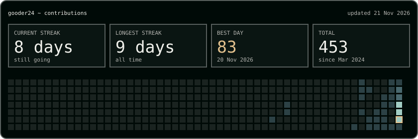

### Karchi · Žilina, Slovakia

I build my own Linux setups and the tools around AI coding agents: a desktop distro for my ThinkPad, servers out of old laptops where agents work day and night, and apps that put my school, messages and calendar in one place.

**Work.** AI software engineer at eSYST (dual education). eSYST reads heat and water meters in apartment buildings and splits the costs between flats. I build SPOTREX, the portal that collects the readings remotely, and the company's AI tools: a local assistant and agents for the team.

**Stack** `TypeScript` `Rust` `Tauri` `QML` `Python` `Shell` · `Arch` `Debian` `Hyprland` `systemd` `QEMU` `Tailscale` `Matrix` · `Claude Code` `Codex` `T3 Code`

**What I'm good at**
- Linux from the ISO up: installers, Debian and Arch packages, every build tested in a VM before it ships
- Machines that run AI agents unattended: updates, reboots and memory handled without breaking a turn
- Desktop apps that stay light on a 2-core laptop
- [Skills](https://github.com/Gooder24/Karchi-skills.md) that teach agents how I work

| Project | What it is |
|---|---|
| [karchi-os-headless-debian](https://github.com/Gooder24/karchi-os-headless-debian) | Debian 13 server OS for old laptops that run AI agents, one offline ISO |
| [laptop-server](https://github.com/Gooder24/laptop-server) · [reboot-when-idle](https://github.com/Gooder24/reboot-when-idle) | The two pieces of it you can install on any Debian |
| [weft](https://github.com/Gooder24/weft) | One inbox for EduPage, Messenger, Instagram, Discord, WhatsApp and mail |
| [kalendarix](https://github.com/Gooder24/kalendarix) | Local-first calendar for tiling Wayland desktops (Rust + TypeScript) |
| [t3-time](https://github.com/Gooder24/t3-time) | How much of your own time each T3 Code thread takes |

Upstream: fixes and bug reports in [T3 Code](https://github.com/pingdotgg/t3code/issues?q=author%3AGooder24), [arboard](https://github.com/1Password/arboard/pulls?q=author%3AGooder24) and [Atlas](https://github.com/neondeex/atlas-filemanager/pulls?q=author%3AGooder24); I also write for [langwhy.dev](https://langwhy.dev).
